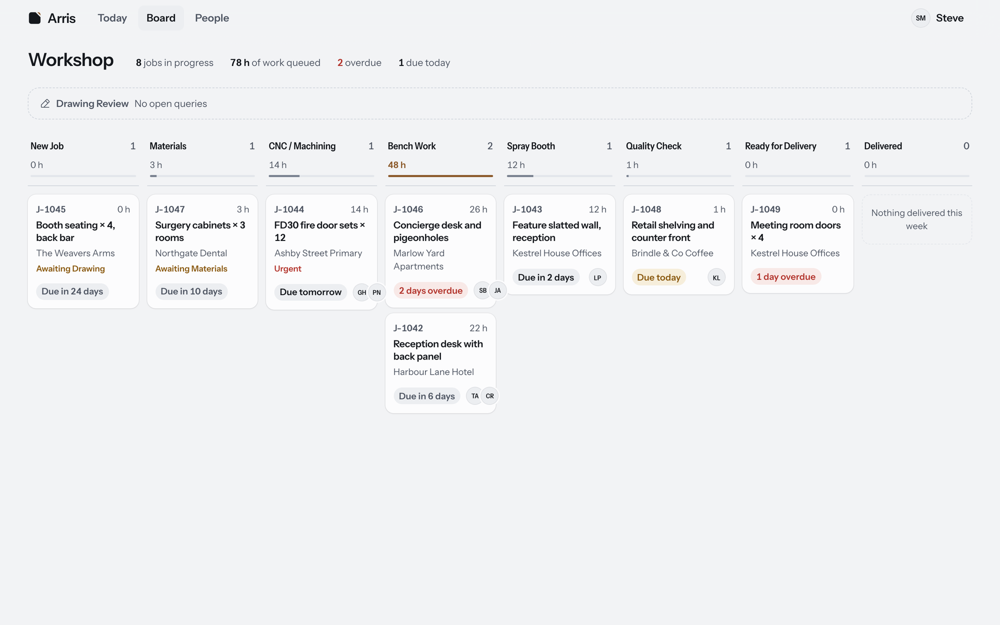
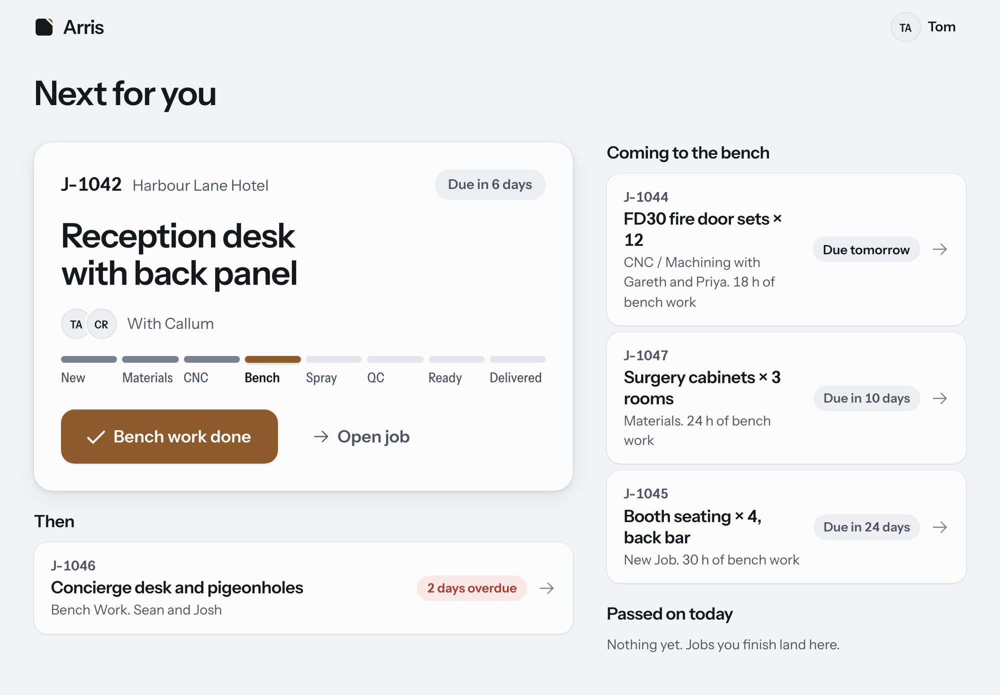
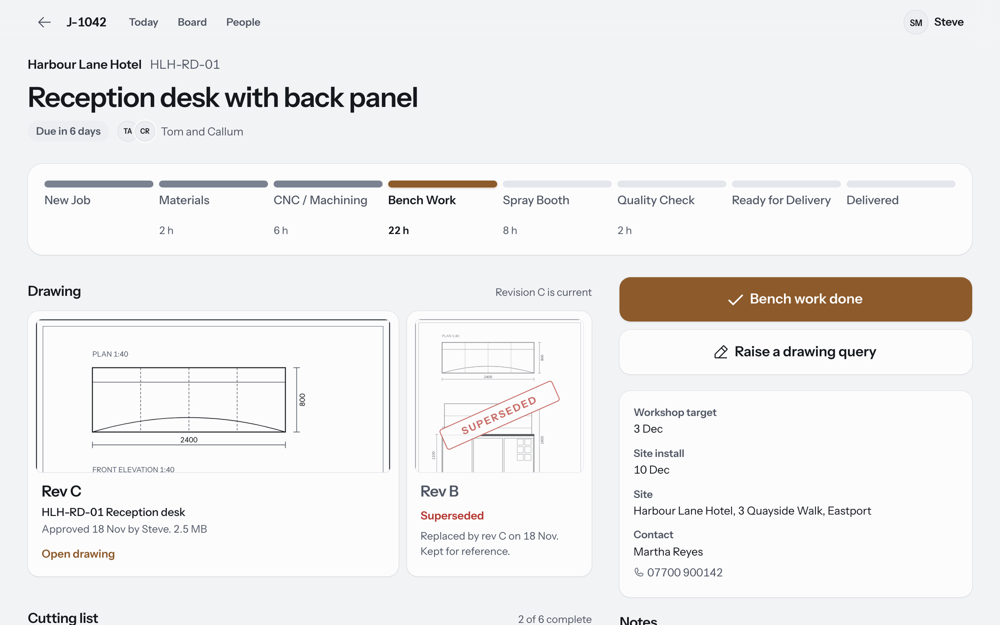

# Arris: a workshop job tracker

[](https://github.com/SammyJ3000/arris/actions/workflows/ci.yml)



*Screenshots use fictional demo data.*

## What it is

Arris is an offline first rebuild of a workshop job tracker, and it is still in
progress. It started life as a prototype made with AI. The prototype looked like an app, but it could not
run a workshop. Login was three buttons. The drawing upload kept the file name
and threw the file away. Two people editing one job meant the last one won, with
no warning. Nothing worked offline.

Arris is the same idea, built properly. Joinery jobs move through fixed stages:
New, Materials, CNC, Bench, Spray, Quality Check, Ready and Delivered. The floor
uses shared tablets on the benches and signs in with a name and a PIN. The
manager works from a laptop in the office. The app works with no signal and
catches up when the signal returns. The server decides who can do what, not the
buttons.

All data in this repo is fictional. Every person, client, supplier and address
is invented. Phone numbers come from Ofcom's reserved drama range (07700 900000
to 07700 900999), so none of them can ring anyone.

## Status

In progress. Stages 0 to 2 are done. Stage 3 is in design.

What works today, on the sample data or a real backend: tablet sign in with a
name and PIN, office sign in, My Jobs (the "next for you" screen on the floor),
the job page with its drawing, the workshop board, the manager's Today view,
raising a drawing query, conflicts when two people change the same job, and
changes made with no signal that sync when it returns.

| Stage | State |
|---|---|
| 0. Setup: brief, domain model, fictional sample workshop | Done |
| 1. Design pass: three directions as clickable prototypes (`design/DESIGN-PASS.md`) | Done. Direction C, "Arris", chosen |
| 2a. App foundations: design system, routes, every screen state | Done |
| 2b. Data foundations: schema, rules, PIN sign in, RLS tests | Done |
| 2c. Offline sync with PowerSync, live end to end tests | Done |
| 3. Vertical slice: one job from creation to delivery | Design in progress |
| 4 to 6. Hardening, polish, breadth | Not started |

What is missing today: creating a job, uploading and approving drawings, the
Quality Check screen, delivery paperwork and the idle lock on tablets. The
Stage 3 handover in `docs/process/handovers/stage-3-design.md` lists it all.

## Screenshots

The tablet view on the bench, signed in as Tom with his next job:



A job page, with the current drawing, the superseded revision and the site details:



## How it works

```
 Tablet / phone / laptop                       Supabase
 ┌─────────────────────────────┐              ┌──────────────────────────────┐
 │ React app (PWA, installable)│  writes ───▶ │ Postgres                     │
 │   reads local SQLite        │  (RPC calls) │   tables, RLS, rule functions│
 │   upload queue when offline │              │   append only history        │
 │ PowerSync web SDK           │ ◀── sync ─── │ Auth (office + PIN)          │
 └─────────────────────────────┘  (PowerSync) │ Storage, Edge Function       │
                                              └──────────────────────────────┘
```

**Reads are local.** The app always reads a SQLite database on the device.
PowerSync streams the server's data down into it. That is why it keeps working
with no signal.

**Writes are function calls.** The app never writes to a table. Every change
calls a Postgres function, such as `advance_job` or `raise_drawing_query`. The
function checks the role, the version and the gates, makes the change and writes
history in one transaction. Row level security is on for every table, and
nobody can insert, update or delete directly.

**Offline changes queue.** With no signal, a change goes into PowerSync's upload
queue and shows on screen straight away. When the signal returns, it is sent
with the same op id, so a retry applies once. If the server now says no (a
conflict, a gate or a warning), the answer is kept on the device and shown to
the person who made the change, with the same choices they would have had live.

**Every outcome is a value.** A change returns `ok`, `queued`, `conflict`,
`refused`, `warning`, `denied` or `error`. The screens design each one. Nothing
throws and nothing fails quietly.

**Conflicts are shown.** Every change carries the version the person last saw.
If someone else got there first, the app says who, on which device, and when,
and asks what to do.

**Tablet sign in.** A manager registers a tablet once. A joiner taps their name
and enters a PIN. The `pin-login` Edge Function checks the tablet and the PIN
(bcrypt, five tries then a five minute lock) and issues a normal short lived
session. A removed tablet loses its data within about a second of the change.

**Sync rules repeat the database rules.** PowerSync bypasses row level
security, so `powersync/sync-config.yaml` rebuilds the same read rules, and a
test suite checks them with PowerSync's own compiler.

There is also an in memory data source with the same sample workshop. The app
uses it when no backend is configured, so you can run the whole thing locally
with no accounts.

## How it was built

I built it with AI, in stages, and the whole process is in the repo. I wrote
the brief for each stage, made the product and design decisions, and reviewed
every stage before the next one started, fixing what was wrong. Claude Code
agents wrote the code to those briefs. The records are in `docs/`:

- **Briefs** (`docs/process/briefs/`). I start each stage with a written brief:
  what to build, the hard rules, what done means and what to report.
- **Reports** (`docs/process/reports/`). Each agent writes back what it built,
  what failed and how it was fixed, what is left, and the test results.
- **Decisions** (`docs/decisions.md`). Every real decision with its reason,
  including the wrong turns.
- **Handovers** (`docs/process/handovers/`). What the next stage needs to know.
- **Build log** (`docs/build-log.md`). What each stage produced, and the follow
  ups from my reviews.

`docs/process/README.md` explains how these fit together.

Tests gate every stage. By the end of Stage 2:

| Suite | Tests |
|---|---|
| App unit tests (Vitest) | 77 |
| End to end on the in memory source (Playwright, tablet and desktop) | 10 |
| End to end against the real backend (Playwright, with video) | 5 |
| Row level security, run as real users against the practice project | 96 |
| PowerSync sync rules and client schema, offline | 39 |

Two working rules came out of the process. The strongest model available does
the judgement work, design and decisions, and a faster one builds from a
settled brief. Agents never read `.env` files or handle secret keys, and `.claude/settings.json`
enforces that for any Claude Code session in this folder.

## What broke, and how it was fixed

All of these are from the reports and the decisions log.

- **Blank page on the first data layer.** It passed class methods to React's
  `useSyncExternalStore`, which calls them unbound. They are arrow properties
  now.
- **Deep links bounced to sign in.** The route guard redirected before the
  effect that signed the test person in. The sign in now happens before the
  first render.
- **An office change was recorded against a tablet.** The manager's password
  session still carried a tablet id from an earlier PIN sign in. Password
  sessions now ignore the tablet id.
- **QC sign off could save without history.** A draft saved the ticked checks
  even when it then refused for having fewer than eight. The write now comes
  after the check.
- **A PIN test failed on its second run.** The lockout counter for unknown
  people persists between runs, just like a real person's. The behaviour was
  right and the test was wrong. It now uses a fresh id each run.
- **A removed tablet went quiet.** It showed an empty "Your bench is clear"
  instead of saying it had been removed. PowerSync removed the rows a moment
  after the status change, so the access check never ran again. The check now
  runs after every local read.
- **The sync config never deployed.** It passed validation in the editor, but
  an earlier deploy had failed silently. It cost an hour. The fix is a habit:
  check Deploy History and the replication slot after every change.
- **The offline cache was too big.** All four SQLite builds were precached, 8.5
  MB. Only the one in use is now, 3.8 MB in total.

## Setup and run

You need Node 22.12 or later and npm. CI runs on Node 22.

### Run it locally on sample data

No accounts needed. With no backend configured, the app uses the in memory
sample workshop.

```sh
cd app
npm ci
npm run dev
```

Demo sign in details (fictional, and the same on the real backend):

- **Office:** `steve.marsden@arris.demo`, password `arris-workshop` (manager).
  `helen.carr@arris.demo` is the read only director.
- **Tablet:** choose Tom, PIN `4826`. Every PIN is listed in
  `supabase/README.md`.

### App checks

From `app/`:

```sh
npm run typecheck
npm run lint
npm test          # unit tests
npm run build
npx playwright install chromium   # first time only
npm run e2e       # end to end on the in memory source, records video
```

### Sync rule tests (offline)

```sh
cd powersync/tests
npm ci
npm test
npm run typecheck
```

### Continuous integration

GitHub Actions (`.github/workflows/ci.yml`) runs all of the checks above on
every push and pull request: the app checks and build, the end to end tests on
the in memory source, and the sync rule tests. It needs no secrets. The backend
tests below need a live project, so they are run by hand.

### Your own backend

You need a Supabase project, a PowerSync Cloud instance and the Supabase CLI.

1. Link the project: `supabase link --project-ref <your-project-ref>`.
2. Apply the schema, rules, storage, seed and nightly reset:
   `supabase db push --linked`.
3. Deploy PIN sign in:
   `supabase functions deploy pin-login --use-api --no-verify-jwt`.
4. Create a database role for PowerSync with replication rights, as the
   PowerSync docs describe. The migrations create the `powersync` publication
   but not the role, because it needs a password you set yourself.
5. In PowerSync, connect the instance to the project with that role, use
   Supabase Auth, and deploy `powersync/sync-config.yaml`. Then check Deploy
   History shows it completed.
6. Copy `.env.example` to `.env.local` at the repo root and fill in the project
   URL, the publishable key and the PowerSync URL. Only the publishable key ever
   goes here, never a secret key.

The app then runs on the real backend. Add `?source=memory` to any URL to switch
back to the sample data.

Backend tests run as real users against that project and need `.env.local`:

```sh
cd supabase/tests
npm ci
npm test          # row level security, gates, PINs, storage
cd ../../app
npm run e2e:live  # resets the demo data before and after
```

`supabase/README.md` documents every function, its outcomes and the demo data.

## Stack

| Layer | Choice |
|---|---|
| App | React 19, TypeScript, Vite, React Router, Motion, Radix |
| Offline shell | `vite-plugin-pwa` (Workbox), installable on a tablet |
| Local data and sync | PowerSync web SDK, local SQLite |
| Database | Supabase Postgres, row level security, rule functions, `pg_cron` |
| Auth | Supabase Auth: email and password for the office, PIN through an Edge Function for the floor |
| Files | Supabase Storage, private buckets |
| Tests | Vitest, Playwright, PowerSync's sync rules compiler |
| Hosting | Vercel |

## Where things are

| Path | What |
|---|---|
| `app/` | The app, its unit tests and Playwright tests |
| `supabase/` | Migrations, the `pin-login` Edge Function, RLS tests |
| `powersync/` | Sync config and its tests |
| `design/` | The design pass: a summary of the three directions, screenshots and the shared sample data. The prototypes are on the [`design-pass` branch](https://github.com/SammyJ3000/arris/tree/design-pass/design) |
| `docs/` | Brief, domain model, architecture, principles, decisions, briefs, reports, handovers |

The README screenshots are in `docs/images/`. Test videos and the working
screenshots from each stage are kept out of the repo.

This repo was published from a private working copy, so earlier history is not
included.

## About me

I'm Sam Jordan. I design and build apps and AI tools. More of my work:
https://sam-jordan-cv.vercel.app
