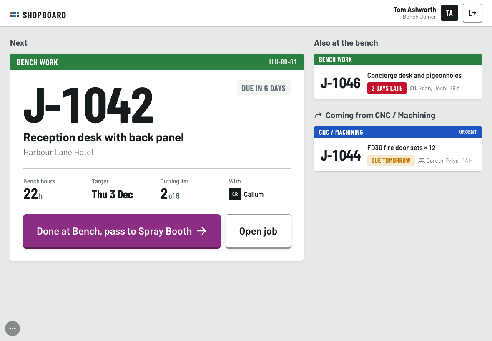
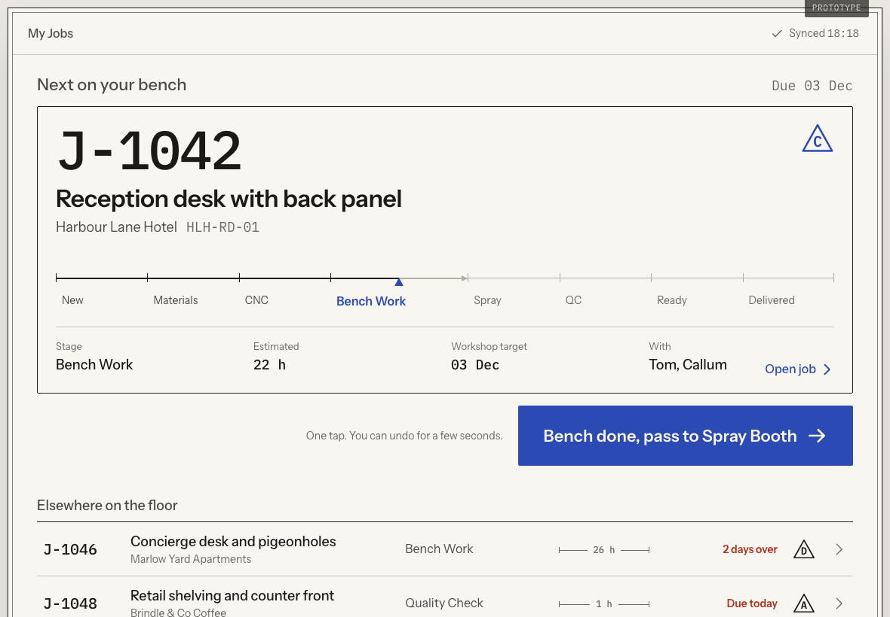
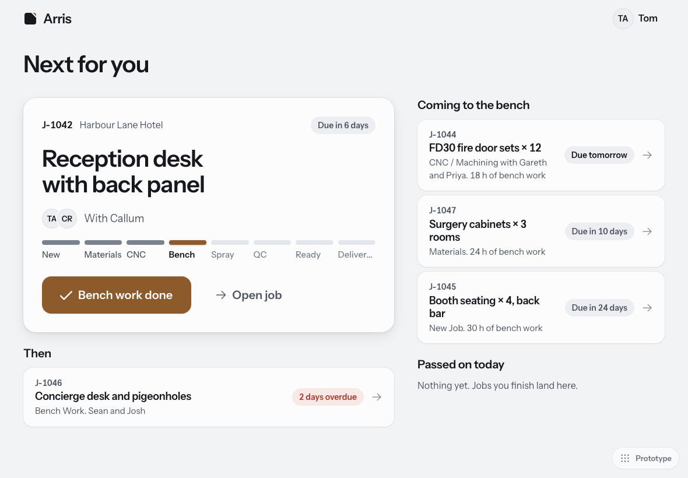

# Design pass

Stage 1 of the build, on 14 and 15 October 2026. I wanted to judge each design by
holding it, not by looking at mockups, so each direction was built as a
clickable prototype on the same fictional workshop. I wrote the brief below,
three agents built one direction each in parallel, and I tested all three on my
phone and tablet before choosing.

The three prototypes are on the
[`design-pass` branch](https://github.com/SammyJ3000/arris/tree/design-pass/design),
each with its own README and build steps. Main keeps this summary, the shared
sample data in `shared/`, and one screenshot of each direction.

## The three directions

Each screenshot is My Jobs on a 1180 × 820 tablet, signed in as Tom, a bench
joiner.

### A: Shopboard ("Shop Floor")

The board on the workshop wall, moved onto the tablet. Each station has one
paint colour, a job ticket is painted the colour of the station it is at, and
controls are keys that sink when pressed. Barlow and Barlow Condensed, chosen
for signage you read at arm's length. The signature moment: passing a job on
repaints the ticket and slides it along the stage rail.



### B: Datum ("Drawing Office")

Every screen is a drawing sheet with a title block. Progress is a dimension
chain, revisions get a triangle with the letter inside, a job in review is
wrapped in a revision cloud, and late work is marked in red pen. IBM Plex Mono
for anything measured, Instrument Sans for everything said. The signature
moment: an approval stamp lands on the drawing gate and the gate opens.



### C: Arris ("Quiet Product"), chosen

The calm, software first answer. Pale surfaces on a cool grey room, one
typeface (Instrument Sans), one accent the colour of oiled oak, and springs
that can be interrupted for every transition. The signature moment: tapping
"Bench work done" moves the stage marker on, and the card hands off to
"Passed on today" while the next job grows into its place.



## Why C

On a phone it felt simplest and cleanest, closest to a well made Apple app.
The review also found what C got wrong: its floor screens were too quiet. Stage
labels were pale, one was cut short ("Deliver…", visible above), and initials
clipped on the board. The app fixed both in its design system and sized floor
type to direction A's legibility, because calm must never mean small or faint.
The full entry is in `../docs/decisions.md`.

## The brief

The brief as I gave it to the three agents. The `direction-<x>/` folders it
names are on the `design-pass` branch.

Three design directions, each built as a **clickable prototype** so I can judge
how it feels, not just how it looks. I pick one, and it becomes the start of the
real build. So build it properly: real components and real tokens, not a throwaway.

Read first: `../docs/brief.md` and `../docs/domain-model.md`.

### The standard

The whole point of this product is proving work "built to an agency standard". If a
screen could have come out of any AI app builder, it has failed. Before you write
any code, load these skills and follow them: `taste-skill`, `emil-design-eng`,
`impeccable`, `frontend-design`, and `animate` for motion.

Explicitly avoid the AI defaults:

- Inter, Space Grotesk, or the system font as the main face
- Stock shadcn/ui looks, `rounded-lg` and a soft shadow on everything
- Purple to blue gradients, near-black with one acid-green accent, cream with a
  terracotta serif
- Emoji as icons. Pick one icon set deliberately and use it consistently
- Everything centred
- Motion everywhere. Use one signature moment and quiet micro-interactions,
  and respect `prefers-reduced-motion`

### Who uses it, and where

- **Joiners on the shop floor**, on a shared tablet on a bench or wall. Arm's length,
  sometimes gloves, dust, noise, bright overhead light. Patchy wifi.
- **The workshop manager**, at a laptop in the office and walking the floor with a
  tablet.
- **A director**, glancing at it occasionally, read only.

Floor screens need big type, big touch targets (48px minimum, more for the main
actions), and must read from a metre away. Office screens can be denser.

### What to build

Use the shared data in `shared/sample-data.ts` and the types in `shared/domain.ts`.
**Copy them into your project** rather than editing the originals. Keep all state
in memory; there is no back end yet.

#### 1. Tablet sign-in, shared device (tablet, 1180 × 820)
The tablet stays signed in as the workshop. A person taps their name, then enters a
four-digit PIN. Show the wrong-PIN state. Include a small "Office sign-in" route for
the manager. PIN for every person in the prototype is **1234**.

#### 2. My Jobs (tablet, operative "Tom Ashworth")
The floor's home screen. "What am I doing next?" is the only question it has to
answer. Next job first, big, obvious. One tap to say a stage is done and pass the
job on. Show an offline indicator state.

#### 3. Job page (tablet, job J-1042)
- Where the job is in the stages, clearly
- The drawing: current revision C, with revision B shown as superseded. Opening it
  shows a full-screen viewer. Render a simple technical drawing of a reception desk
  as SVG for now; the real app will use PDFs
- Cutting list where each component's status can be advanced with a tap
- "Raise a drawing query" from the floor: a sheet with a note and an optional photo,
  which sends the job to Drawing Review
- Materials with their statuses

#### 4. The gates, demonstrated
- **Drawing gate:** J-1045 has no drawing. Trying to move it on is blocked, and the
  screen explains why and what to do
- **Materials check:** moving J-1047 from Materials to CNC warns that items are still
  Required or Ordered, lists them, and lets the manager continue or wait

#### 5. Board (desktop, 1440 × 900, manager "Steve Marsden")
Stage columns, urgency, the Drawing Review lane, and load per stage **in hours**
(the jobs carry estimated hours per stage). Dense but calm.

#### 6. States
Somewhere in the prototype, design each of these properly: loading (skeletons, not
spinners), empty, offline, **a conflict** ("Tom changed this job on the bench tablet
2 minutes ago", with a clear choice), permission denied (an operative trying a
manager action), and an error with a way out.

### Product name

Propose a product name and a simple wordmark for your direction. The name should
fit a tool for joinery and fit-out workshops. Not "Joinery Tracker".

### Build

- Vite, React, TypeScript, and Motion (`motion/react`) for animation. Radix
  primitives are fine. Tailwind is allowed but must not look like Tailwind defaults.
- Define the design tokens (colour, type scale, spacing, radius, elevation, motion
  durations and easings) as CSS variables in one place, and use them everywhere.
- Fonts from Google Fonts only, with proper fallbacks. No external images; draw
  with SVG or embed as data URIs.
- `npm run build` must produce **one self-contained `dist/index.html`** using
  `vite-plugin-singlefile`. It gets published as a private link I open on my
  tablet and phone.
- Use a hash route or in-app navigation so all six areas are reachable from a small,
  unobtrusive "prototype" menu.

### Check your work

Screenshot every screen once at its intended size (tablet 1180 × 820, desktop
1440 × 900, plus My Jobs on a phone at 390 × 844), look at them, fix what is wrong,
and stop. No endless loops. Playwright is available:

```
python your_script.py   # Playwright for Python
```

Save screenshots to `capture/screenshots/design-pass/<your-direction>/`.

### Rules

- Work only in your own `design/direction-<x>/` folder, plus your screenshot folder.
  `design/shared/` is read only.
- All data stays fictional. Do not add real names, companies or phone numbers.
- No em dashes in any user-facing copy. British English.

### Deliver

1. The project in `design/direction-<x>/`, building to a single `dist/index.html`
2. `design/direction-<x>/README.md`: the concept in a paragraph, the product name
   and why, the palette, the type pairing, the motion principle and the signature
   moment, and what you would change with more time
3. Screenshots in your capture folder
4. A short final report: what you built, where it is, and anything that didn't work
